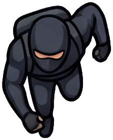

<div dir="rtl">

# השוד המושלם: רמת המדריך | PERFECT HEIST – Tutorial Level

**מטלה 3, חלק ב** בקורס פיתוח משחקי מחשב.
**חברי הצוות:** כפיר נזרי, אביתר אהרון.

> **השוד מתחיל בתוכנית טובה, לא במרוץ נגד השעון.**

| | |
|---|---|
| **לשחק בדפדפן, ולהוריד APK לאנדרואיד** | **[kfir-and-evyatar.itch.io/perfect-heist-guide-level](https://kfir-and-evyatar.itch.io/perfect-heist-guide-level)** (גם בטלפון, לרוחב) |
| **סרטון מהטלפון** | *(יתווסף)* |
| **תכנון הרמות של המשחק הזה** | [Level_Design.md: השוד המושלם](https://github.com/Kfir-And-Evyatar-Game-Dev/---Perfect-Heist/blob/main/Level_Design.md), עם מפות ותרשימים |

### הריפוזיטוריז של חלק א (תכנון רמות לכל N+1 המשחקים)
| משחק | ריפו |
|---|---|
| השוד המושלם (המשחק שמומש כאן) | [---Perfect-Heist](https://github.com/Kfir-And-Evyatar-Game-Dev/---Perfect-Heist) |
| כיבוש המפה | [---Map-Conquest](https://github.com/Kfir-And-Evyatar-Game-Dev/---Map-Conquest) |
| רעש שמציל | [---sound-of-survival](https://github.com/Kfir-And-Evyatar-Game-Dev/---sound-of-survival) |

---

## על המשחק

"השוד המושלם" הוא משחק תכנון דו־ממדי במבט מלמעלה. בוחרים צוות שודדים, נותנים לכל דמות פקודות על **ציר זמן**, ורק כשהתוכנית מוכנה לוחצים **RUN** וצופים בדמויות מבצעות אותה לבד. **אין הגבלת זמן לתכנון.** אם השוד נכשל, מקבלים הסבר מה השתבש, והתוכנית נשמרת כדי לתקן אותה.

בריפו הזה ממומשת **רמת המדריך**. היא מלמדת את המשחק צעד אחר צעד, ברמת פירוט שמתאימה גם למי שלא שיחק אף פעם: בכל צעד מסומן בהילה הדבר היחיד שאפשר ללחוץ עליו, עם הסבר קצר מה לעשות.

   

## מהלך המשחק

1. **דף הבית:** בוחרים שוד. המדריך פתוח, ושאר השודים (חנות תכשיטים, מוזיאון, בנק) נעולים.
2. **בחירת צוות:** חמש דמויות. לחיצה על דמות מציגה את היכולות שלה. במדריך בוחרים את **ההאקר** ואת **המתגנב**. שאר הדמויות מוצגות כצלליות נעולות.
3. **מפת התכנון:** רואים את השומר ואת מסלול הסיור שלו, את המצלמה ואת טווח הראייה שלה, את היהלום ואת רכב המילוט.
   - **לחיצה על דמות** פותחת את חלון ציר הזמן שלה, עם הפעולות שלה בלבד: הליכה, המתנה והרמה לכולם, ו־**כיבוי מצלמה** להאקר בלבד.
   - **ציר הזמן** מציג גם את השורות של שאר הדמויות, כדי לתאם תזמון.
4. **RUN:** הדמויות מבצעות את התוכנית. מי שמסיים את התוכנית ליד הרכב נכנס אליו, ואחרי שכולם בפנים עם היהלום הרכב נוסע ממסך המפה.
5. **סיום:**
   - **הצלחה:** עוברים למסך ניצחון, עם זמן ההרצה ומספר הניסיונות.
   - **כישלון:** חלון "Attempt failed" עם הסיבה, למשל "Sneak was seen by the guard at second 13.0", וחזרה לתכנון.

**שליטה:** לחיצה או הקשה בלבד, אותו קוד לעכבר ולמגע. המשחק מוצג לרוחב (Landscape).

---

## ארבעת הנושאים של המטלה, ואיפה הם בקוד

### 1. דגמים (Prefabs) ויצירה אוטומטית (Spawn), כולל דגמים מבינה מלאכותית
- **5 Prefabs** בתיקייה `Assets/Prefabs`: ‏Character, ‏Guard, ‏SecurityCamera, ‏Diamond ו־Exit (רכב המילוט).
- **[`LevelSpawner.cs`](Assets/Scripts/LevelSpawner.cs)** קורא את המפה, שכתובה כטקסט באותה צורה כמו במסמך התכנון, ויוצר עותק של ה־Prefab המתאים לכל תו עם `Instantiate`:

  | תו | נוצר |
  |---|---|
  | `&` | מצלמה |
  | `1` | שומר |
  | `$` | יהלום |
  | `X` | רכב מילוט |
  | `P` | הצוות שנבחר |

- **דגמים מ־AI:** את הדמויות, השומר, המצלמה, היהלום והרכב יצרנו ב־**Gemini**. הסרנו את הרקע וחתכנו כל אחד לקובץ PNG שקוף.
- גם המפה עצמה נבנית מקוד: [`MapBuilder.cs`](Assets/Scripts/MapBuilder.cs) מצייר רצפה וקירות דקים מאותה טבלת טקסט.

### 2. התנגשויות (דו־ממד)
- **דמויות:** ‏`Rigidbody2D` מסוג Kinematic ו־`CircleCollider2D`. הן זזות עם `MovePosition`, כדי שהפיזיקה תזהה מגע.
- **Triggers:**

  | אובייקט | מה קורה במגע | קוד |
  |---|---|---|
  | **מצלמה** | ‏`OnTriggerStay2D`: דמות בתוך הטווח, כשהמצלמה פעילה, מתגלה | [`SecurityCamera.cs`](Assets/Scripts/SecurityCamera.cs) |
  | **יהלום** | הדמות יודעת שהיא עומדת עליו ויכולה להרים אותו | [`Character.cs`](Assets/Scripts/Character.cs), [`Diamond.cs`](Assets/Scripts/Diamond.cs) |
  | **רכב המילוט** | דמות שסיימה את התוכנית בתוך הטריגר נכנסת לרכב תוך חצי שנייה, ואחר כך הרכב נוסע | [`ExitZone.cs`](Assets/Scripts/ExitZone.cs) |

- **השומר:** רואה 3 משבצות קדימה בזווית של 90°, ולא רואה דרך קירות ([`Guard.cs`](Assets/Scripts/Guard.cs)).

### 3. ניהול רמות ושמירת ערכי משתנים
- **[`GameManager.cs`](Assets/Scripts/GameManager.cs):** ‏**Singleton** עם **`DontDestroyOnLoad`**. הוא עובר בין הסצנות ושומר את השוד שנבחר, את הצוות, את מספר הניסיונות ואת זמן ההרצה. גם "המדריך הושלם" נשמר במכשיר עם `PlayerPrefs`.
- **ארבע סצנות:** ‏`MainMenu`, ‏`TeamSelect`, ‏`Tutorial` ו־`Win`.
- **מסך ניצחון** ([`WinScreen.cs`](Assets/Scripts/WinScreen.cs)) מציג את הערכים שנשמרו ב־GameManager.
- **חלון כישלון** מחזיר לתכנון, והתוכנית נשמרת.

### 4. התאמה לטלפונים ניידים
- **מסך לרוחב בלבד.**
- **אותו קוד לעכבר ולמגע:** אירועי UI, בלי מקשים.
- **כפתורים גדולים:** ממשק בקנה מידה של 1920×1080 שמתאים את עצמו לכל מסך.
- **[`CameraFit.cs`](Assets/Scripts/CameraFit.cs)** מתאים את הזום של המצלמה כך שהמפה נכנסת לכל יחס מסך.
- **בנייה ל־WebGL** (itch.io, בדפדפן של הטלפון) **ול־Android** (APK).

---

## מבנה הקוד

| קובץ | תפקיד |
|---|---|
| `RunClock.cs` | שעון ההרצה **הדטרמיניסטי**: אותה תוכנית תמיד נותנת אותה תוצאה. מחליט על הצלחה או כישלון |
| `Commands.cs` | פקודות ציר הזמן: הליכה (מסלול BFS מסביב לקירות), המתנה, כיבוי מצלמה והרמה |
| `PlanningUI.cs` | מסך התכנון: לחיצה על דמות, חלון ציר הזמן, כפתורי הפעולות וחלון הכישלון |
| `TutorialDirector.cs` | שלבי המדריך במפה (כ־40 צעדים) |
| `GuideOverlay.cs`, `GuideRunner.cs` | מערכת ההדרכה: החשכה, הילה, חץ, בועת טקסט, וחסימת לחיצות מחוץ להילה |
| `MainMenuScreen.cs`, `TeamSelectScreen.cs`, `WinScreen.cs` | המסכים. הממשק נבנה בקוד, ונוצר אוטומטית עם `ScreenBootstrap.cs` |
| `UIKit.cs`, `CharacterCatalog.cs` | עזרים לבניית ממשק, ונתוני הדמויות |

---

## פתיחת הפרויקט

1. **Unity 6.3 LTS** (גרסה **6000.3.27f1**), תבנית Universal 2D.
2. משכפלים את הריפו ופותחים אותו דרך Unity Hub. הפתיחה הראשונה לוקחת כמה דקות, כי Unity בונה מחדש את התיקייה `Library`.
3. פותחים את הסצנה `Assets/Scenes/MainMenu` ולוחצים ▶.
4. **לאיפוס ההדרכה בדף הבית:** ‏**Edit**, ‏**Clear All PlayerPrefs**.

### בנייה
- **WebGL ל־itch.io:** ‏**Tools**, ‏**Perfect Heist**, ‏**Build WebGL for itch.io**. נוצר הקובץ `Builds/PerfectHeist-WebGL.zip`, שאותו מעלים ל־itch.io כפרויקט HTML.
- **Android:** ‏**Tools**, ‏**Perfect Heist**, ‏**Build Android APK**. נוצר הקובץ `Builds/PerfectHeist.apk`, שמתקינים בטלפון ומעלים לאותו דף ב־itch.io כקובץ להורדה.

### בדיקת קוד (Linter)
הקובץ `.github/workflows/linter.yml` הוא הלינטר של הקורס, בלי שינויים. הוא מריץ `dotnet-format` על `Assets/Scripts` בכל push. אפשר לבדוק לפני push עם:

```
dotnet format whitespace Assets/Scripts --folder --verify-no-changes
```

---

## עזרה וכלי בינה מלאכותית

| כלי | למה השתמשנו בו |
|---|---|
| **Claude Code** (Anthropic) | כתיבת הקוד יחד איתנו, תכנון הארכיטקטורה (שעון הרצה דטרמיניסטי, פקודות, מערכת ההדרכה), כתיבת מסמך תכנון הרמות וה־README, ועיבוד התמונות: הסרת רקע מזויף וחיתוך לקבצים נפרדים |
| **Gemini** (Google) | יצירת התמונות של הדמויות, השומר, המצלמה, היהלום ורכב המילוט |

**איך עבדנו עם Claude:** תיארנו מה אנחנו רוצים: מסכים, חוקים, איך המדריך צריך ללמד. Claude כתב קוד, ואנחנו בדקנו כל שלב ב־Unity, מצאנו בעיות והחזרנו משוב. שנינו עברנו על הקוד ומבינים כל חלק בו, כמו שהקורס דורש.

</div>
